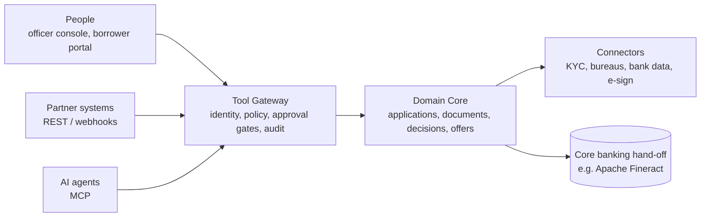

# Tamarind LOS

**An open-source, lightweight, agent-native Loan Origination System.**

Tamarind helps lenders take a loan application from intake to an approved, signed offer, with AI agents doing the routine work and people staying in control of credit decisions.

> **Status: design phase.** The concept and architecture are being defined in the open. There is no runnable code yet. See the [roadmap](#roadmap) and [open decisions](docs/adr/README.md).

---

## Why Tamarind?

Most loan origination software is built for people clicking through screens. AI gets bolted on afterwards, as a chat window that can't act safely or explain what it did.

Tamarind is **agent-native**: AI agents and people use the **same set of governed actions**, under explicit identity, policy and audit. Agents handle document chasing, data extraction and verification. People supervise, approve and handle exceptions.

Read the full rationale in [Concept Paper 01: Agent-Native Systems](docs/concept/01-agent-native-concept-paper.md).

## Key ideas

- **One action surface.** The officer console, partner APIs and AI agents all call the same typed tools through one gateway. No side doors.
- **Open protocols.** Tools are exposed over the Model Context Protocol (MCP) for agents and OpenAPI for systems.
- **Humans decide credit.** Rules and scoring models decide, AI writes the analysis, and a person approves, unless a lender explicitly configures otherwise for a narrow, low-risk segment.
- **Explainable by default.** Every recommendation and decision produces a structured decision record. Every action records who did it, on whose behalf, and why.
- **Tiered autonomy.** Lenders set, per action, how much agents may do on their own (L0 manual to L4 autonomous within policy).
- **Model-agnostic.** Bring any model provider, including self-hosted models.
- **Lightweight.** Designed to run on a single server with PostgreSQL and object storage, and to scale out without a redesign.

## Architecture at a glance

Details: [Technical Paper 02: Reference Architecture](docs/architecture/02-reference-architecture.md).

## Scope

| In scope | Out of scope (integrate instead) |
|---|---|
| Application intake, document collection and extraction, KYC/KYB orchestration, eligibility and policy checks, decision recommendation, approval workflow, offers, audit trail, hand-off | Loan servicing, repayments, collections, general ledger: handed off to systems such as Apache Fineract / Mifos X |

## Documentation

| Document | Description |
|---|---|
| [Concept Paper 01](docs/concept/01-agent-native-concept-paper.md) | What an agent-native system is, and why Tamarind is one |
| [Technical Paper 02](docs/architecture/02-reference-architecture.md) | Reference architecture: components, contracts, data model, security |
| [Architecture Decision Records](docs/adr/README.md) | Key technical decisions and their status |

## Roadmap

| Phase | Outcome | Status |
|---|---|---|
| **Design** | Concept, reference architecture, core decisions | In progress |
| **0 — Foundations** | Tool gateway, domain core, state machine, audit ledger, REST + MCP adapters, mock connectors | Planned |
| **1 — Assisted origination** | Officer console, document pipeline, intake and document agents, decision records | Planned |
| **2 — Supervised automation** | Verification agent, policy packs, approval gates, evaluation harness, Fineract hand-off | Planned |
| **3 — Ecosystem** | Borrower portal, external agent access, more connectors and jurisdiction packs | Planned |

## Contributing

Tamarind is at the stage where design feedback is the most valuable contribution. Read [CONTRIBUTING.md](CONTRIBUTING.md), then open an issue or comment on a proposed ADR. All participants are expected to follow the [Code of Conduct](CODE_OF_CONDUCT.md).

## License

Currently released under the [MIT License](LICENSE). The project licence is under review in [ADR-0003](docs/adr/0003-licence.md).

## Disclaimer

Tamarind is software, not legal or compliance advice. Lenders that deploy it remain responsible for meeting the lending, data-protection and consumer-protection requirements of their jurisdictions.
