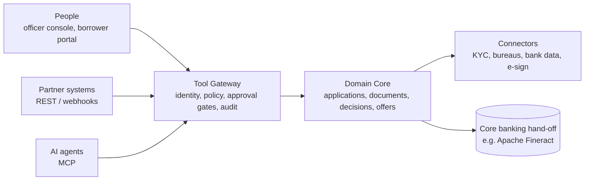

# Tamarind LOS

**An open-source, lightweight, agent-native Loan Origination System.**

Tamarind helps lenders take a loan application from intake to an approved, signed offer, with AI agents doing the routine work and people staying in control of credit decisions.

> **Status: Phase 0 (foundations).** One SME loan runs from intake to booking: borrower consent, verification checks through mock connectors, CEL policy rules, an agent-proposed recommendation, a human approval within limits, an offer the borrower accepts, and a hand-off to (mock) core banking. Everything goes through one tool gateway over REST and MCP, with Cedar authorization, agent autonomy levels and a hash-chained audit log on PostgreSQL. It is not ready for real data. See the [roadmap](#roadmap) and [open decisions](docs/adr/README.md).

---

## Why Tamarind?

Most loan origination software is built for people clicking through screens. AI gets bolted on afterwards, as a chat window that can't act safely or explain what it did.

Tamarind is **agent-native**: AI agents and people use the **same set of governed actions**, under explicit identity, policy and audit. Agents handle document chasing, data extraction and verification. People supervise, approve and handle exceptions.

Read the full rationale in [Concept Paper 01: Agent-Native Systems](docs/concept/01-agent-native-concept-paper.md).

## Key ideas

- **One action surface.** The officer console, partner APIs and AI agents all call the same typed tools through one gateway. No side doors.
- **Open protocols.** Tools are exposed over the Model Context Protocol (MCP) for agents and OpenAPI for systems.
- **Humans decide credit.** Rules and scoring models decide, AI writes the analysis, and a person approves, unless a lender explicitly configures otherwise for a narrow, low-risk segment.
- **Explainable by default.** Every recommendation and decision produces a structured decision record. Every action records who did it, on whose behalf, and why.
- **Tiered autonomy.** Lenders set, per action, how much agents may do on their own (L0 manual to L4 autonomous within policy).
- **Model-agnostic.** Bring any model provider, including self-hosted models.
- **Lightweight.** Designed to run on a single server with PostgreSQL and object storage, and to scale out without a redesign.

## Architecture at a glance



Details: [Technical Paper 02: Reference Architecture](docs/architecture/02-reference-architecture.md).

## Technology

| Layer | Choice | Decision |
|---|---|---|
| Core and Tool Gateway | Go | [ADR-0001](docs/adr/0001-core-language.md) |
| Agent runtime | Python | [ADR-0001](docs/adr/0001-core-language.md) |
| Officer console and borrower portal | TypeScript (React) | [ADR-0001](docs/adr/0001-core-language.md) |
| Policy | Cedar (authorization) and CEL (business rules) | [ADR-0004](docs/adr/0004-policy-engine.md) |
| Data | PostgreSQL and S3-compatible object storage | [Reference Architecture](docs/architecture/02-reference-architecture.md) |
| First reference product | SME working-capital loan | [ADR-0002](docs/adr/0002-first-reference-product-and-market.md) |

## Quick start

```bash
cd deploy/compose
docker compose up --build
curl -s localhost:8080/healthz
```

On Windows, `deploy/compose/demo.ps1` runs the whole story and checks each step. Otherwise follow the walkthrough in [services/core/README.md](services/core/README.md): agents create and verify an application, propose a decision for a human to approve, and a loan is offered, accepted and booked.

## Scope

| In scope | Out of scope (integrate instead) |
|---|---|
| Application intake, document collection and extraction, KYC/KYB orchestration, eligibility and policy checks, decision recommendation, approval workflow, offers, audit trail, hand-off | Loan servicing, repayments, collections, general ledger: handed off to systems such as Apache Fineract / Mifos X |

## Documentation

| Document | Description |
|---|---|
| [Concept Paper 01](docs/concept/01-agent-native-concept-paper.md) | What an agent-native system is, and why Tamarind is one |
| [Technical Paper 02](docs/architecture/02-reference-architecture.md) | Reference architecture: components, contracts, data model, security |
| [Architecture Decision Records](docs/adr/README.md) | Key technical decisions and their status |
| [Specifications](docs/specs/README.md) | Tool catalogue, data model and the SME working-capital reference product |

## Roadmap

| Phase | Outcome | Status |
|---|---|---|
| **Design** | Concept, reference architecture, core decisions, specifications | Done |
| **0 — Foundations** | Tool gateway, domain core, state machine, audit ledger, REST + MCP adapters, mock connectors | In progress: gateway, REST + MCP, audit ledger, CI, mock connectors and the full intake-to-booking journey done; outbox relay and Python agent runtime next |
| **1 — Assisted origination** | Officer console, document pipeline, intake and document agents, decision records | Planned |
| **2 — Supervised automation** | Verification agent, policy packs, approval gates, evaluation harness, Fineract hand-off | Planned |
| **3 — Ecosystem** | Borrower portal, external agent access, more connectors and jurisdiction packs | Planned |

## Contributing

Tamarind is at the stage where design feedback is the most valuable contribution. Read [CONTRIBUTING.md](CONTRIBUTING.md), then open an issue or comment on a proposed ADR. All participants are expected to follow the [Code of Conduct](CODE_OF_CONDUCT.md).

## License

Licensed under the [Apache License 2.0](LICENSE). See [NOTICE](NOTICE) and [ADR-0003](docs/adr/0003-licence.md).

## Disclaimer

Tamarind is software, not legal or compliance advice. Lenders that deploy it remain responsible for meeting the lending, data-protection and consumer-protection requirements of their jurisdictions.
