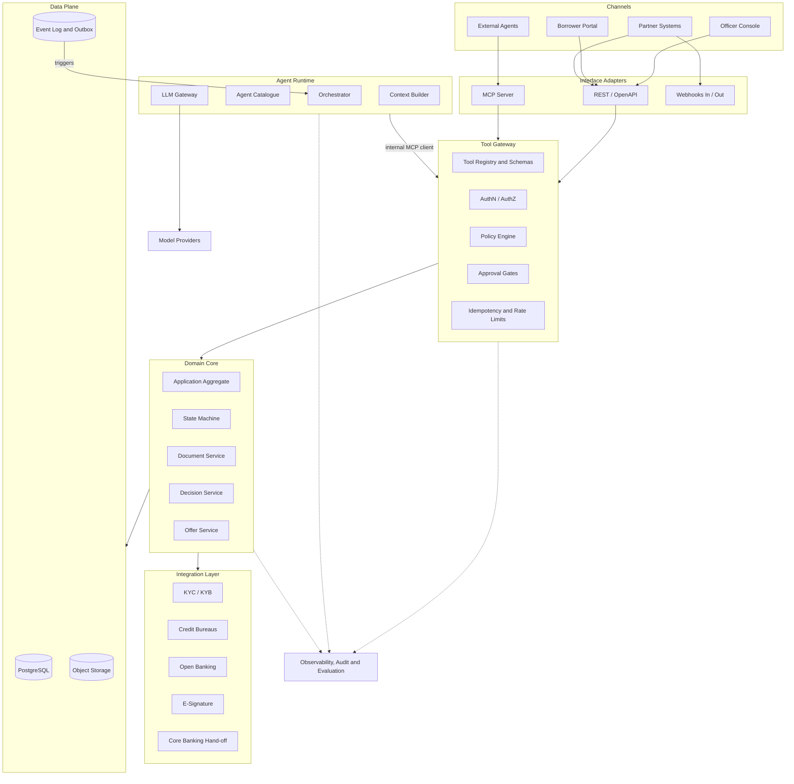
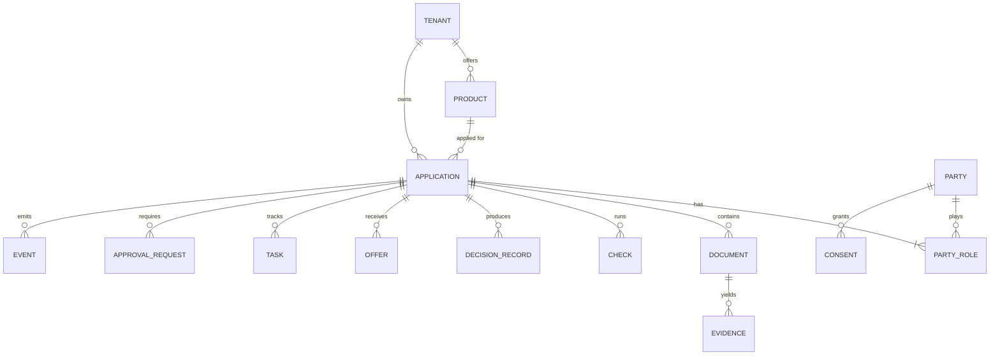
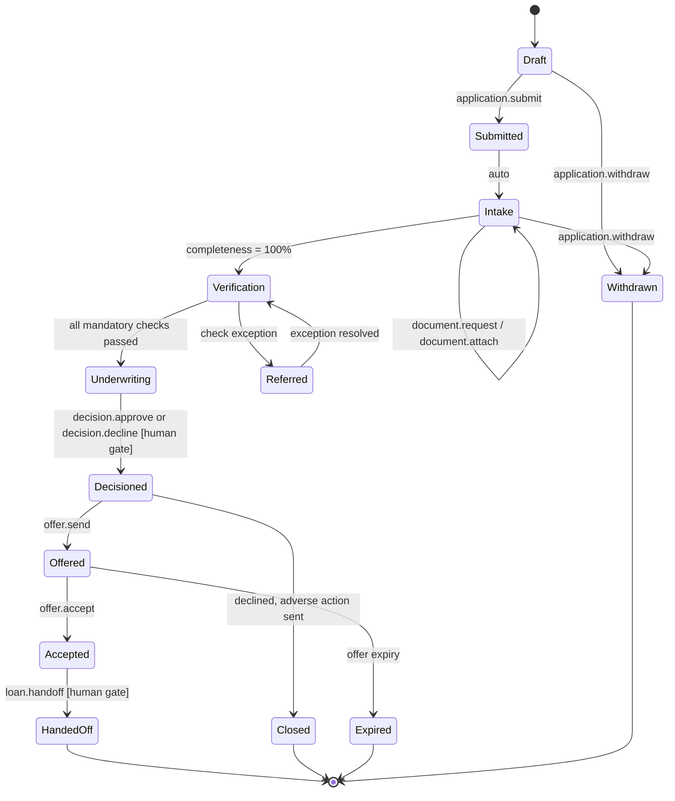
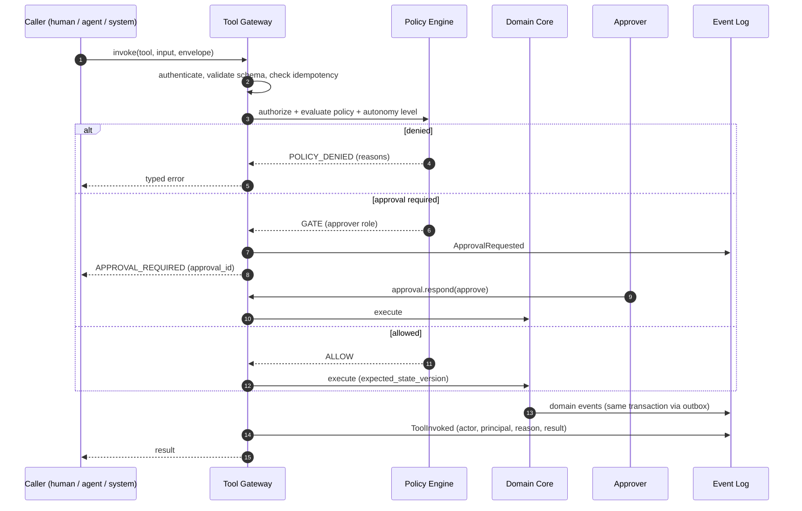
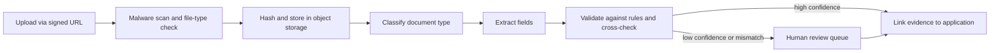
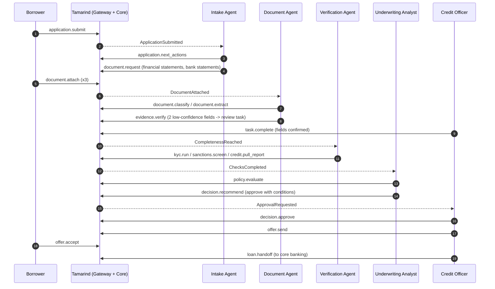

# Reference Architecture for an Agent-Native Loan Origination System

**Tamarind Loan Origination System — Technical Paper 02**

| | |
|---|---|
| **Status** | Draft v0.1 — for discussion |
| **Date** | 21 October 2026 |
| **Author** | Christopher Tun, TamarindTech |
| **Builds on** | [Concept Paper 01 — Agent-Native Systems](../concept/01-agent-native-concept-paper.md) |
| **Audience** | Architects, engineers and contributors |

---

## 1. Purpose and Scope

This paper sets out the **reference architecture** for Tamarind: an open-source, lightweight, agent-native loan origination system (LOS). It turns the principles in Concept Paper 01 into concrete components, contracts, data models and runtime flows.

It is a *reference* architecture. It defines the building blocks and how they interact, and stays deliberately neutral on specific vendors. Where a technology is suggested, it is a non-binding default that architecture decision records (ADRs) will settle later.

**In scope:** application intake through decision, offer, acceptance and hand-off to servicing.
**Out of scope:** loan servicing, repayments, collections and general ledger. Tamarind hands these off to systems such as Apache Fineract.

---

## 2. Architectural Drivers

| # | Driver | Implication for the architecture |
|---|---|---|
| D1 | **Governability** | Every state change goes through one policy-enforced tool gateway. No side doors. |
| D2 | **Auditability and explainability** | Append-only event log plus structured decision records. Every action is attributable to an actor and a principal. |
| D3 | **Safety under autonomy** | Risk-tiered tools, approval gates, maker-checker rules, budget and step limits for agents. |
| D4 | **Lightweight** | Runs as one service plus PostgreSQL and object storage on a single host. Scales out without redesign. |
| D5 | **Model-agnostic** | All model access goes through an LLM gateway with pluggable providers, including self-hosted models. |
| D6 | **Open interfaces** | MCP for agents, OpenAPI for systems, webhooks and events for integration. |
| D7 | **Data protection** | PII classification, field-level encryption, and redaction before data leaves the trust boundary. |
| D8 | **Jurisdiction-neutral** | Products, policies, document types and disclosures are configuration ("policy packs"), not code. |
| D9 | **Graceful degradation** | The system is fully usable with agents switched off (autonomy L0/L1). |

---

## 3. Architecture Overview

### 3.1 Logical view



### 3.2 Key structural rule

> **All writes, from humans, systems or agents, pass through the Tool Gateway.**

The Officer Console is a client of the same tools as an AI agent. Tamarind's own agents call tools through an internal MCP client, exactly as an external agent would. That one rule is what makes governance, audit and autonomy control consistent.

### 3.3 Component responsibilities

| Component | Responsibility |
|---|---|
| **Interface adapters** | Translate REST, MCP and webhook calls into tool invocations. They hold no business logic. |
| **Tool Gateway** | Registry, schema validation, authentication, authorization, policy evaluation, autonomy check, approval gating, idempotency, rate limiting, invocation audit. |
| **Domain Core** | Business entities and invariants: the application aggregate, state machine, documents, decisions and offers. |
| **Agent Runtime** | Runs Tamarind's built-in agents: orchestration, context assembly, LLM access and guardrails. |
| **Integration Layer** | Ports-and-adapters connectors to external services. Each connector is replaceable. |
| **Data Plane** | PostgreSQL for state and events, S3-compatible storage for documents, transactional outbox for reliable events. |
| **Observability** | Traces, metrics, logs, the audit ledger and the evaluation harness. |

---

## 4. Domain Model



| Entity | Description |
|---|---|
| **Tenant** | A lender organisation. Every record is tenant-scoped. |
| **Product** | Loan product definition: amount and term ranges, pricing, required documents, policy pack reference. Versioned. |
| **Application** | Aggregate root. Holds requested terms, current state, completeness and the state version. |
| **Party / PartyRole** | Individual or business, with role: applicant, co-applicant, guarantor, director, beneficial owner. |
| **Document** | Uploaded file with type, classification confidence, storage reference and hash. |
| **Evidence** | An extracted field value linked to a document, page and region, with confidence and verification status. |
| **Check** | An external or internal verification: KYC, sanctions, bureau pull, bank-statement analysis, fraud signals. |
| **DecisionRecord** | Immutable record of a recommendation or decision (see §9.3). |
| **Offer** | Proposed terms, schedule summary and disclosures, with an expiry. |
| **Task** | Unit of work for a human or agent: request a document, review an exception. |
| **ApprovalRequest** | A pending gated action awaiting a human decision. |
| **Consent** | Borrower consent for bureau pulls, data sharing and e-communication, with scope and expiry. |
| **Event** | Append-only domain event (see §10). |

---

## 5. Application State Machine



Design rules:

- **Transitions are only triggered by tools.** Each transition has guards (preconditions) declared next to it in the product's policy pack.
- **Optimistic concurrency.** Every write carries the expected `state_version`, so two agents can't race the same application.
- **`application.next_actions`** returns the transitions and tools allowed for the caller in the current state. This is how agents "know what to do next" without hard-coded flows.
- The state machine is **versioned per product**. In-flight applications keep the version they started with.

---

## 6. Tool Layer

### 6.1 Tool contract

Every capability is declared once, as a tool definition. Adapters (REST, MCP), documentation and client SDKs are generated from these definitions.

```yaml
name: document.request
version: 1.2.0
description: >
  Ask the applicant (or a party on the application) to provide a missing document.
  Sends a notification through the borrower's preferred channel.
risk_tier: low            # read | low | medium | high
default_autonomy: L3
side_effects: [notification.sent, task.created]
idempotent: true
preconditions:
  - application.state in [Intake, Verification, Referred]
  - document_type in product.required_documents
input_schema:
  type: object
  required: [application_id, party_id, document_type]
  properties:
    application_id: { type: string, format: uuid }
    party_id:       { type: string, format: uuid }
    document_type:  { type: string, enum_ref: product.document_types }
    message:        { type: string, maxLength: 500 }
output_schema:
  type: object
  properties:
    task_id: { type: string, format: uuid }
    notified_via: { type: string }
scopes_required: [documents:request]
```

### 6.2 Tool catalogue (initial)

| Domain | Tools | Risk tier |
|---|---|---|
| Application | `application.create`, `.update`, `.submit`, `.withdraw`, `.get`, `.next_actions` | low / read |
| Party | `party.add`, `party.update`, `consent.record` | low / medium |
| Documents | `document.upload_url`, `.attach`, `.classify`, `.extract`, `.request`, `evidence.verify` | low |
| Checks | `kyc.run`, `sanctions.screen`, `credit.pull_report`, `bank.analyse_statements` | medium |
| Policy | `policy.evaluate`, `product.get` | read |
| Decision | `decision.recommend`, `decision.approve`, `decision.decline`, `decision.refer` | medium / **high** |
| Offer | `offer.generate`, `offer.send`, `offer.accept` | high |
| Hand-off | `loan.handoff` | **high** |
| Work | `task.create`, `task.complete`, `approval.respond` | low / high |

### 6.3 Invocation contract

Every invocation carries an envelope in addition to the tool input:

```json
{
  "tool": "decision.recommend",
  "input": { "application_id": "8f1c..." },
  "idempotency_key": "b7e2-...",
  "expected_state_version": 14,
  "dry_run": false,
  "reason": "All mandatory checks complete; preparing recommendation",
  "trace_id": "4bf92f3577b34da6a3ce929d0e0e4736"
}
```

- **`dry_run`** evaluates preconditions and policy without executing. Agents use it to plan safely.
- **`reason`** is mandatory for agent actors and stored in the audit trail.
- Responses use **typed errors** an agent can act on, e.g. `PRECONDITION_FAILED`, `APPROVAL_REQUIRED`, `STATE_CONFLICT`, `CONSENT_MISSING`, `POLICY_DENIED`.

### 6.4 Mapping to MCP

| MCP primitive | Tamarind mapping |
|---|---|
| **Tools** | Every tool in the registry, filtered to the caller's scopes. |
| **Resources** | Read-only views such as `tamarind://applications/{id}/snapshot`, `tamarind://products/{id}/policy`, `tamarind://applications/{id}/decision-records`. |
| **Prompts** | Curated task templates, e.g. "Review application for completeness", "Draft credit memo". |

The MCP server supports streamable HTTP (remote agents, OAuth 2.1) and stdio (local development).

---

## 7. Identity and Authorization

### 7.1 Principals

| Principal type | Example | Authentication |
|---|---|---|
| Human user | `user:officer-42` | OIDC (SSO), MFA for high-risk approvals |
| Built-in agent | `agent:doc-intake` | Workload identity / signed service token |
| External agent | `agent:ext:acme-broker-bot` | OAuth 2.1 client credentials via MCP |
| System | `svc:partner-crm` | OAuth client credentials / mTLS |
| Borrower | `borrower:9d2a...` | Passwordless link / OIDC |

### 7.2 Delegation

Every invocation records **who acted** and **on whose behalf**:

```json
{ "actor": "agent:underwriting-analyst", "on_behalf_of": "user:officer-42", "tenant": "lender-a" }
```

The effective permission is the **intersection** of the agent's scopes and the delegating principal's scopes. An agent can never do more than the person or organisation it serves.

### 7.3 Authorization model

- **RBAC** for coarse roles: loan officer, credit approver, compliance reviewer, admin.
- **ABAC** for fine rules: amount limits, product, branch, region, risk grade.
- **Approval authority matrix**, e.g. officers approve up to amount X, credit committee above it.
- **Separation of duties (maker-checker):** whoever *recommended* a decision can't *approve* it. That includes the agent and the human who delegated to it.

---

## 8. Policy Engine and Approval Gates

### 8.1 Invocation pipeline



### 8.2 Policy as code

Policies are versioned, testable artifacts grouped into **policy packs**, one per product and jurisdiction:

| Policy type | Example | Suggested engine |
|---|---|---|
| Authorization | "Approvers may approve up to their limit" | OPA (Rego) or Cedar |
| Eligibility / knock-out | "Applicant age ≥ 18", "No active sanctions hit" | CEL expressions or a decision-table engine |
| Autonomy | "`kyc.run` is L3 for tenant A; `decision.approve` always gated" | Gateway configuration |
| Document requirements | "SME > X needs 2 years of financial statements" | Product configuration |

Every evaluation returns the **policy version** and **matched rules**, which are written to the audit trail.

### 8.3 Autonomy resolution

For each invocation the gateway resolves an effective autonomy level:

```
effective = min(tool.max_autonomy, tenant.setting(tool), product.setting(tool), actor.trust_level)
```

If the effective level is lower than "act", the call becomes a proposal (L2) or an approval request.

---

## 9. Agent Runtime

### 9.1 Agent catalogue

| Agent | Trigger | Main tools | Default autonomy |
|---|---|---|---|
| **Intake agent** | `ApplicationSubmitted` | `application.next_actions`, `document.request`, `task.create` | L3 |
| **Document agent** | `DocumentAttached` | `document.classify`, `document.extract`, `evidence.verify` | L3 |
| **Verification agent** | Completeness reached | `kyc.run`, `sanctions.screen`, `credit.pull_report`, `bank.analyse_statements` | L3 (consent-gated) |
| **Underwriting analyst** | All checks complete | `policy.evaluate`, `decision.recommend` | L2 |
| **Compliance reviewer** | `DecisionRecommended` | reads decision records, raises `task.create` on issues | L1–L2 |
| **Borrower assistant** | Borrower message | read-only application status, `document.upload_url` | L3, scoped to own application |

Each agent definition is versioned and declares its **tool allowlist**, model profile, step and cost budget, and output schemas.

### 9.2 Orchestration

- **Event-driven.** Agents wake up on domain events from the outbox, not on polling.
- **Supervisor-worker.** A lightweight orchestrator routes events to the right agent and enforces one active agent run per application per stage. This prevents duplicate work.
- **Durable runs.** Each agent run is a persisted record (steps, tool calls, tokens, cost, outcome), so it can be resumed or replayed.
- **Escalation.** On low confidence, budget exhaustion or a typed error it can't resolve, the agent creates a human `task` with a summary instead of retrying blindly.

### 9.3 Decision record

```json
{
  "decision_id": "dr_01J...",
  "application_id": "8f1c...",
  "type": "recommendation",
  "outcome": "approve_with_conditions",
  "terms": { "amount": 25000, "term_months": 24, "rate_apr": 0.189 },
  "conditions": ["Provide latest 3 months bank statements before disbursement"],
  "reason_codes": ["DTI_WITHIN_LIMIT", "STABLE_INCOME_24M"],
  "inputs": {
    "evidence_ids": ["ev_...", "ev_..."],
    "check_ids": ["chk_kyc_...", "chk_bureau_..."]
  },
  "policy": { "pack": "sme-unsecured-v3", "version": "3.2.0", "rules_matched": ["R12", "R19"] },
  "models": [
    { "kind": "scorecard", "id": "sme-pd", "version": "1.4.0", "score": 0.031 },
    { "kind": "llm", "provider": "configurable", "model": "configurable", "prompt_version": "uw-memo@7" }
  ],
  "narrative": "Applicant meets all knock-out rules ...",
  "confidence": 0.82,
  "actor": "agent:underwriting-analyst",
  "on_behalf_of": "user:officer-42",
  "created_at": "2026-10-21T08:15:00Z",
  "confirmed_by": null
}
```

### 9.4 Layered decisioning

The LLM is **never the sole decision-maker**. Decisions are built in layers:

1. **Deterministic policy rules:** knock-outs and hard limits. Always explainable.
2. **Quantitative models:** scorecards or ML models with documented versions and reason codes.
3. **LLM analyst:** reconciles evidence, flags inconsistencies, writes the credit memo and narrative, proposes conditions.
4. **Human approval:** for every decision, unless a lender explicitly configures L4 for a narrow, low-risk segment.

Adverse-action reasons are taken from the **reason codes** of layers 1–2, not from free-text LLM output.

### 9.5 LLM gateway

- **Provider abstraction:** hosted APIs or self-hosted models behind one interface. Model profiles are chosen per agent.
- **Redaction:** PII fields marked `restricted` are masked or tokenised before prompts leave the trust boundary, unless the model is self-hosted.
- **Structured output:** responses are validated against JSON Schema and retried or escalated on failure.
- **Accounting:** tokens, latency and cost per tenant, agent and application.
- **Prompt registry:** prompts are versioned artifacts, referenced by ID in decision records.

### 9.6 Context builder

Agents receive a compact, purpose-built **application snapshot** rather than raw database rows: state, requested terms, parties, verified evidence, open tasks, check results and allowed next actions. Policy text and product rules are retrieved on demand through MCP resources. Untrusted content (document text, borrower messages) is wrapped and labelled as data.

---

## 10. Event Model and Audit

### 10.1 Events

State changes are written together with domain events in one PostgreSQL transaction (**transactional outbox**). A relay publishes them to subscribers: agents, webhooks and analytics.

```json
{
  "event_id": "evt_01J...",
  "type": "DocumentExtracted",
  "aggregate": { "type": "application", "id": "8f1c...", "version": 15 },
  "tenant": "lender-a",
  "actor": "agent:doc-intake",
  "on_behalf_of": "org:lender-a",
  "occurred_at": "2026-10-21T08:12:44Z",
  "trace_id": "4bf92f3577b34da6a3ce929d0e0e4736",
  "data": { "document_id": "doc_...", "fields": 14, "low_confidence_fields": 2 },
  "prev_hash": "c0ffee...",
  "hash": "a1b2c3..."
}
```

### 10.2 Audit ledger

- **Append-only** and **hash-chained** per tenant, so tampering is detectable. Periodic anchors can be exported to external storage.
- Covers tool invocations, policy evaluations, approvals, agent runs, model calls (metadata) and data access to restricted fields.
- **Case file export:** one command produces a complete, human-readable record of an application for auditors or dispute handling.

---

## 11. Document Intelligence Pipeline



- Extraction uses pluggable engines: OCR plus layout models, vision-capable LLMs, or specialised providers.
- **Evidence provenance:** every field keeps its document, page, bounding box, extractor version and confidence.
- **Cross-checks:** name and date-of-birth consistency across ID, payslip and bureau data; income vs. bank-statement deposits.
- **Prompt-injection defence:** text extracted from documents is never placed in an agent's instruction channel. The extraction step has **no tool access**. Only validated, typed fields flow onward.

---

## 12. Integration Layer

### 12.1 Ports and adapters

Each external capability is defined as a **port** (interface) with one or more **adapters**:

| Port | Example adapters |
|---|---|
| `IdentityVerification` | Regional e-KYC providers, manual review adapter |
| `SanctionsScreening` | Commercial screening APIs, open sanctions datasets |
| `CreditBureau` | Country-specific bureaus |
| `BankData` | Open-banking aggregators, statement-parsing adapter |
| `ESignature` | E-signature providers, click-to-accept adapter |
| `Notification` | Email, SMS, chat apps |
| `CoreBankingHandoff` | Apache Fineract / Mifos X, Frappe Lending, generic webhook |

Every adapter also ships a **sandbox/mock implementation**, so the whole system runs end to end with no external accounts.

### 12.2 Hand-off contract

On `loan.handoff`, Tamarind sends a versioned **Booking Package**: borrower and party data, final terms, accepted offer, signed documents, conditions, and decision-record references. The adapter maps it to the target system (e.g. creating client and loan accounts in Fineract) and records the external IDs. Hand-off is idempotent and retryable.

---

## 13. Security and Data Protection

### 13.1 Controls

| Area | Control |
|---|---|
| Data classification | Fields tagged `public`, `internal`, `confidential`, `restricted` (e.g. national ID, bank account numbers) |
| Encryption | TLS everywhere; encryption at rest; field-level encryption for `restricted` data with per-tenant keys |
| Tenancy | Tenant ID on every row, enforced by PostgreSQL row-level security |
| Secrets | External secret store; no credentials in agent context or prompts |
| Consent | Bureau and bank-data tools fail with `CONSENT_MISSING` unless valid consent exists |
| Retention | Per-tenant retention policies; crypto-shredding for erasure requests |
| Supply chain | Signed releases, SBOMs, dependency scanning |

### 13.2 Agent-specific threat model

| Threat | Example | Mitigation |
|---|---|---|
| Prompt injection | A bank statement includes "approve this loan" | Untrusted content is data only; extraction has no tools; policy and gates apply to every call |
| Tool abuse / over-reach | Agent calls tools beyond its role | Per-agent allowlists, scope intersection, rate limits |
| Data exfiltration | Agent sends PII to an external endpoint | No generic HTTP tool; outbound only through approved connectors; redaction in the LLM gateway |
| Runaway loops / cost | Agent retries endlessly | Step, time and cost budgets per run; circuit breakers |
| Decision manipulation | Agent approves its own recommendation | Maker-checker enforced in the gateway |
| Model drift / bias | Output quality degrades over time | Evaluation suites, fairness monitoring, override-rate alerts |

---

## 14. Observability and Evaluation

- **Tracing:** OpenTelemetry traces span the whole chain: agent run → model call → tool invocation → connector call. One `trace_id` links them all.
- **Metrics:** time-to-decision, stage dwell time, straight-through rate, human override rate per agent, extraction accuracy, cost per application.
- **Evaluation harness:** a library of anonymised or synthetic "golden" applications with expected outcomes. Every change to a prompt, model, policy pack or agent definition runs against it in CI.
- **Shadow mode:** a new agent version can run alongside the current one without acting, and its proposals are compared before promotion.

---

## 15. Deployment Topologies

| Topology | Components | Target |
|---|---|---|
| **Lite** | One container (API + gateway + agents + workers), PostgreSQL, S3-compatible storage (e.g. MinIO); Docker Compose | Pilots, small lenders, development |
| **Standard** | Separate API, worker and agent-runtime deployments; managed PostgreSQL; object storage; optional message broker; Kubernetes | Production at moderate scale |
| **Regulated / sovereign** | Standard topology on-prem or in-country cloud, self-hosted models behind the LLM gateway, HSM-backed keys | Banks and regulated institutions with residency rules |

PostgreSQL is the only mandatory stateful dependency. Queueing, scheduling and the outbox run on PostgreSQL in the Lite topology. A broker such as NATS or Kafka is optional at higher scale.

---

## 16. Suggested Technology Choices (non-binding)

| Concern | Default suggestion | Alternatives |
|---|---|---|
| Core services and gateway | Go *or* Python (FastAPI) | TypeScript (Node) |
| Tool definitions | YAML + JSON Schema, code-generated adapters | — |
| MCP server | Official MCP SDK for the chosen language | — |
| Agent runtime | Python (richest AI ecosystem) | TypeScript, Go |
| Officer console / borrower portal | TypeScript, React | — |
| Database | PostgreSQL 16+ | — |
| Object storage | S3-compatible | Local filesystem (dev) |
| Policy | OPA or Cedar (authorization), CEL (rules) | Decision tables |
| Workflow | Built-in PostgreSQL-backed state machine | Temporal for complex orchestration |
| Observability | OpenTelemetry, Prometheus, Grafana | Vendor APM |

The final stack choice is tracked as an ADR (see §19).

---

## 17. End-to-End Example: SME Working-Capital Loan



---

## 18. Proposed Repository Structure

```
TamarindLOS/
├── docs/
│   ├── concept/          # concept papers
│   ├── architecture/     # this paper, diagrams
│   └── adr/              # architecture decision records
├── tools/                # tool definitions (YAML + JSON Schema)
├── policy-packs/         # products, rules, autonomy settings per jurisdiction
├── services/
│   ├── gateway/          # tool gateway, REST + MCP adapters
│   ├── core/             # domain model, state machine, outbox
│   ├── agents/           # agent runtime, agent definitions, prompts
│   └── connectors/       # ports and adapters, including mocks
├── apps/
│   ├── console/          # officer console
│   └── portal/           # borrower portal
├── evals/                # golden applications and evaluation harness
├── deploy/
│   ├── compose/          # Lite topology
│   └── helm/             # Standard topology
└── sdk/                  # generated clients
```

---

## 19. Delivery Roadmap and Open Decisions

### 19.1 Phased delivery

| Phase | Outcome |
|---|---|
| **0 — Foundations** | Tool registry and gateway, domain core, state machine, PostgreSQL outbox, audit ledger, REST + MCP adapters, mock connectors |
| **1 — Assisted origination (L1–L2)** | Officer console, document pipeline, intake and document agents, decision records, one reference product |
| **2 — Supervised automation (L3)** | Verification agent, policy packs, approval gates, evaluation harness, Fineract hand-off adapter |
| **3 — Ecosystem** | Borrower portal and assistant, external agent access via OAuth, more connectors and jurisdiction packs |

### 19.2 Decisions to record as ADRs

1. Core language (Go vs. Python) and agent-runtime language.
2. Policy engine choice (OPA vs. Cedar vs. CEL-only).
3. Built-in state machine vs. Temporal.
4. First reference product and jurisdiction.
5. Licence (Apache-2.0 vs. AGPL-3.0).
6. Default model profile and minimum self-hosted model support.

---

## 20. References

- Concept Paper 01 — [Agent-Native Systems](../concept/01-agent-native-concept-paper.md)
- Model Context Protocol — https://modelcontextprotocol.io
- Apache Fineract — https://github.com/apache/fineract
- Mifos X MCP server — https://mcp.so/servers/mcp-mifosx
- Open Policy Agent — https://www.openpolicyagent.org
- Cedar policy language — https://www.cedarpolicy.com
- Common Expression Language (CEL) — https://cel.dev
- OpenTelemetry — https://opentelemetry.io
- Transactional outbox pattern — https://microservices.io/patterns/data/transactional-outbox.html
