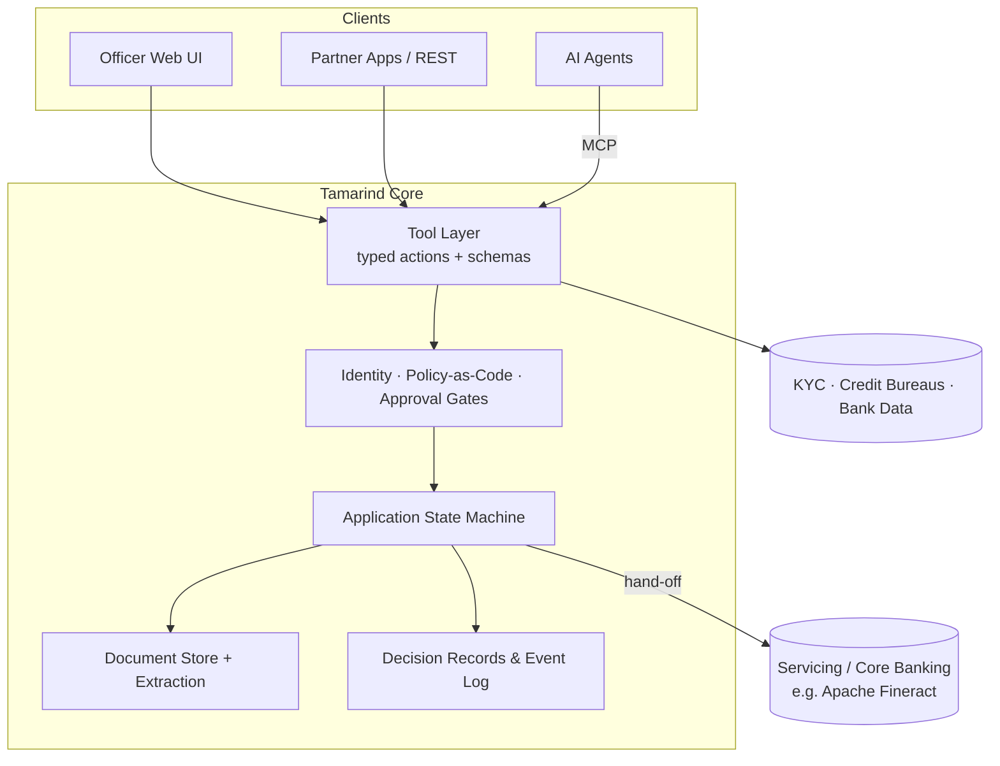

# Agent-Native Systems: What They Are and Why We Are Building One

**Tamarind Loan Origination System — Concept Paper 01**

| | |
|---|---|
| **Status** | Draft v0.1 — for discussion |
| **Date** | 21 October 2026 |
| **Author** | Christopher Tun, Paythonic AI Lab |
| **Audience** | Contributors, design partners, lenders evaluating Tamarind |

---

## 1. Summary

Most business software is built for people sitting in front of screens. When AI agents are added later, they get bolted on: chat windows over the old UI, scripts that click buttons, or brittle integrations that guess at the system's intent.

An **agent-native system** is designed from day one so that AI agents are **first-class operators** next to human users. Every capability is an explicit, typed and permissioned action. Every piece of state can be read and reasoned about by a machine. Every action, whether a person or an agent took it, is attributable, explainable and governed by policy.

Tamarind applies this idea to **loan origination**. That is a document-heavy, rule-heavy and heavily regulated workflow, where agents can add the most value and where getting governance wrong costs the most. This paper defines the term, sets out the design principles, and explains why now and why lending.

---

## 2. The Problem: Software Built for Screens

Software has gone through three broad generations of "who is the user":

1. **Human-native.** The UI *is* the product. Business logic is tangled into forms and screens. Automation means RPA (robotic process automation) bots that mimic clicks.
2. **API-first.** Capabilities are exposed over APIs so other *systems* can integrate. The APIs are designed for developers who read documentation and write deterministic code.
3. **Agent-bolted-on.** An LLM assistant is placed on top of a generation-1 or generation-2 system. It can summarise and draft, but it can't safely *act*. When it does act, it does so with the full permissions of the human it sits beside, and leaves no clear record of why.

In loan origination the consequences are familiar:

- Loan officers spend most of their time on **document chasing, re-keying data and checking completeness**, not on credit judgement.
- Decisions are **hard to reconstruct**: what data was used, which policy version applied, and who (or what) recommended the outcome.
- Automation is **fragile and opaque**. It is either hard-coded rules nobody dares to change, or ML models nobody can explain to a regulator or a declined applicant.
- Adding AI makes the governance problem **worse, not better**, because the system was never designed to tell a person's actions apart from a machine's.

---

## 3. Definition

> **An agent-native system is software in which AI agents and humans operate the same well-defined set of capabilities, through the same governed interface, under explicit identity, policy and audit, with humans supervising outcomes rather than executing every step.**

In practice, it has five defining properties:

| Property | What it means |
|---|---|
| **Actionable** | Every business capability is exposed as a discoverable, typed *tool* with a clear contract (inputs, outputs, side effects, preconditions). |
| **Legible** | System state, domain objects and workflow stages are machine-readable and described in meaningful terms, not hidden in UI layouts. |
| **Accountable** | Every actor (human, agent, service) has its own identity and scoped authority. Every action records who did it, on whose behalf, and why. |
| **Governed** | Policies are code, not tribal knowledge. Risky actions need a human approval gate. How much an agent may do on its own is configurable, not assumed. |
| **Open** | Built on open protocols (e.g. MCP, OpenAPI) and model-agnostic, so lenders are not locked into one AI vendor. |

### 3.1 How it differs

| | Human-native | API-first | Agent-bolted-on | **Agent-native** |
|---|---|---|---|---|
| Primary operator | Human via UI | Developer-written code | Human, with AI assistant | Humans **and** agents |
| Unit of capability | Screen / form | Endpoint | Prompt | **Typed tool with policy** |
| Agent identity | n/a | Shared API key | Borrowed from human | **Own identity, delegated scope** |
| Explainability | Manual notes | Logs | Chat transcript | **Structured decision record** |
| Autonomy control | n/a | All-or-nothing | Ad hoc | **Tiered, per action** |
| Human role | Does the work | Builds integrations | Checks AI output | **Supervises, approves, handles exceptions** |

---

## 4. Design Principles

These principles guide every design decision in Tamarind.

### P1 — One action surface
Every capability is defined once, as a tool. The web UI, the REST API and AI agents (via MCP) are all **clients of the same tool layer**. No agent gets a back door, and no human-only path skips policy.

### P2 — Explicit state machine
The loan application lifecycle is an explicit, versioned state machine (e.g. `draft → submitted → in_review → decisioned → offered → accepted → handed_off`). Agents can always ask *"where is this application, what is missing, and what actions are allowed next?"*

### P3 — Identity and delegated authority
Agents are named principals with their own credentials, scopes and rate limits. An action records both the **actor** (e.g. `agent:doc-intake`) and the **principal it acts for** (e.g. `user:officer-42` or `org:lender-a`). Least privilege by default.

### P4 — Policy as code, with human gates
Credit policy, eligibility rules and approval authority are versioned code or configuration. Each tool declares a **risk tier**. High-impact actions such as approving, declining or disbursing need a human approval gate unless the lender's policy explicitly allows otherwise.

### P5 — Decision records by default
Every recommendation or decision produces a structured record: inputs used, data sources, policy version, model and prompt version, reasoning summary, confidence, and the human who confirmed it. This is the basis for audit, adverse-action explanations and model-risk review.

### P6 — Safe actions
Actions are idempotent, validated before they execute, and append-only (event-sourced) wherever practical. Agents can *propose* changes as drafts that humans accept, which makes errors cheap to reverse.

### P7 — Documents as data
Uploaded documents are classified, extracted and linked to the fields they support, with provenance back to the page and region. Agents reason over structured evidence, not raw PDFs.

### P8 — Model-agnostic and protocol-open
No dependency on a single LLM provider. Tools are exposed over **MCP** for agents and **OpenAPI** for conventional integration. Lenders can bring their own models, including on-premise ones.

### P9 — Observable and evaluable
Agent behaviour is measured: task success, override rates, latency, cost, and drift. Changes to prompts, models or policies run against test suites of past applications before release.

---

## 5. Levels of Autonomy

Agent-native does **not** mean "fully autonomous". Each lender sets autonomy **per action**, matched to its risk appetite and regulatory context.

| Level | Name | Agent does | Human does | Lending example |
|---|---|---|---|---|
| **L0** | Manual | Nothing | Everything | Traditional processing |
| **L1** | Assist | Summarises, highlights gaps | Decides and acts | "This application is missing 2 payslips" |
| **L2** | Propose | Drafts actions and decisions | Reviews and approves each one | Draft credit memo, recommended terms |
| **L3** | Act with oversight | Executes low-risk actions | Handles exceptions, reviews samples | Auto-request missing documents, auto-run KYC |
| **L4** | Autonomous within policy | Executes end to end inside hard limits | Audits, sets policy | Auto-approve small loans meeting strict criteria |

Tamarind's default posture: **L3 for operational tasks, L2 for credit decisions**, with L4 only when a lender explicitly configures it.

---

## 6. Why Now

1. **Models can do the work.** Current models can read messy documents, follow multi-step procedures, call tools reliably and explain their reasoning well enough to be useful in operations.
2. **Protocols have emerged.** The **Model Context Protocol (MCP)** gives a common, open way for agents to discover and call tools. Building on a standard is now practical; inventing one is not.
3. **The industry is moving.** Commercial lending platforms such as **Blend** and **nCino** have released MCP servers for AI agents. The **Mifos community** has published an MCP server for Apache Fineract. Agent access is becoming expected.
4. **There is an open-source gap.** Open-source lending software is strong in *servicing and core banking* (Apache Fineract, Frappe Lending), but weak in *origination*: existing LOS projects are small, inactive or demos. Nothing open source is agent-native at the origination layer.
5. **Cost and inclusion pressure.** Smaller lenders, microfinance institutions and fintechs in emerging markets can't afford enterprise LOS licences or large operations teams. Agent-native automation lowers both barriers.

---

## 7. Why Lending

Loan origination is an ideal, and demanding, proving ground:

- **High-volume, structured judgement.** Each application follows a known process with clear evidence requirements: a natural fit for tools and state machines.
- **Document-intensive.** Identity documents, payslips, bank statements and business records are exactly where agents save the most human time.
- **Heavily regulated.** Fair-lending rules, adverse-action explanations, KYC/AML obligations and model-risk management expectations demand **explainability and audit**. In the EU, the AI Act treats creditworthiness assessment of individuals as a high-risk use. A system that can't show its work can't be deployed.
- **Clear human accountability.** Credit decisions must stay attributable to accountable people and approved policy, which is exactly what principles P3–P5 provide.

If agent-native design works under lending's constraints, it can work almost anywhere.

---

## 8. What This Means for Tamarind

Tamarind is an **open-source, lightweight, agent-native loan origination system**. It focuses on the origination stage and hands booked loans to existing servicing and core-banking systems.

### 8.1 Scope

- **In scope:** application intake, document collection and extraction, KYC/KYB orchestration, data enrichment, eligibility and policy checks, decision recommendation, approval workflow, offer generation, audit trail, and hand-off.
- **Out of scope (integrate instead):** loan servicing, repayment, collections and general-ledger accounting. These hand off to systems such as Apache Fineract / Mifos X or Frappe Lending.

### 8.2 Illustrative tool surface

| Tool | Risk tier | Default autonomy |
|---|---|---|
| `application.create` / `application.update` | Low | L3 |
| `application.get_status` / `application.next_actions` | Read | L4 |
| `document.request` / `document.classify` / `document.extract` | Low | L3 |
| `kyc.run_check` | Medium | L3 |
| `credit.pull_report` | Medium (consent-gated) | L3 |
| `policy.evaluate` | Read | L4 |
| `decision.recommend` | Medium | L2 |
| `decision.approve` / `decision.decline` | **High** | **Human gate** |
| `offer.generate` / `offer.send` | High | L2 |
| `loan.handoff` | High | Human gate |

### 8.3 Reference architecture

### 8.4 "Lightweight" means

- Runs as a small number of services with one relational database, deployable on a single VM or container host.
- Sensible defaults out of the box. Every integration and model is pluggable.
- Usable without any AI at all (L0/L1), so lenders can adopt agents gradually.

---

## 9. Risks and Mitigations

| Risk | Mitigation |
|---|---|
| Agent makes a wrong or biased decision | Human gates on credit decisions; decision records; fairness and drift monitoring; evaluation suites |
| Prompt injection via uploaded documents | Treat document content as data, never instructions; isolate extraction from action-taking; policy checks on every tool call |
| Over-privileged agents | Per-agent identities, least-privilege scopes, rate limits, separation of duties |
| Data privacy and residency | Self-hostable; pluggable / on-prem models; field-level redaction before sending data to external models |
| Regulatory uncertainty | Jurisdiction-specific policy packs; conservative autonomy defaults; complete audit trail |
| Vendor lock-in | Open protocols (MCP, OpenAPI); model-agnostic adapters |

---

## 10. Non-Goals

- Not a replacement for core banking or loan servicing.
- Not a fully autonomous "AI lender". Humans remain accountable for credit decisions.
- Not tied to a single model, cloud or jurisdiction.

---

## 11. Open Questions

1. **Target first segment:** consumer, SME or microfinance lending? This sets the first policy pack and document types.
2. **Reference jurisdiction(s)** for the first compliance mapping.
3. **Core stack:** Python, TypeScript or Go for the core and tool layer?
4. **Default servicing integration:** Apache Fineract first, or a generic hand-off contract?
5. **Licence:** Apache-2.0 (permissive, encourages adoption) vs. AGPL/GPL (keeps derivatives open)?

---

## 12. References

- Apache Fineract — https://github.com/apache/fineract
- Mifos X MCP server for Fineract — https://mcp.so/servers/mcp-mifosx
- Frappe Lending — https://github.com/frappe/lending
- DigiFi open-source LOS — https://github.com/getsan4u/loan-origination-system
- OpenCBS — https://github.com/OPENCBS/
- Model Context Protocol — https://modelcontextprotocol.io
- Blend MCP server announcement — https://nationalmortgageprofessional.com/news/blend-opens-lending-platform-ai-agents-new-mcp-server
- nCino Mortgage MCP announcement — https://www.ncino.com/news/ncino-releases-mortgage-mcp-connect-ai-agents
