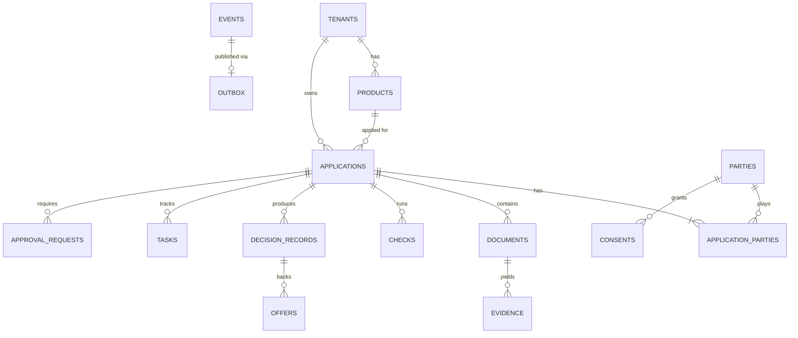

# Spec 04: Data Model

| | |
|---|---|
| **Status** | Draft v0.1 |
| **Date** | 22 October 2026 |
| **Author** | Christopher Tun, TamarindTech |
| **Implements** | [Reference Architecture §4, §10, §13](../architecture/02-reference-architecture.md) |
| **Source** | [services/core/migrations/0001_init.sql](../../services/core/migrations/0001_init.sql) (PostgreSQL 16+) |

## 1. Principles

| Principle | How the schema enforces it |
|---|---|
| **Tenant isolation** | Every business table has `tenant_id`. Row-level security (forced, including for the table owner) filters on the session setting `tamarind.tenant_id`. Composite foreign keys `(tenant_id, id)` stop cross-tenant references. |
| **Exact money** | Amounts are `bigint` minor units plus `char(3)` currency. Rates are basis points. |
| **Typed principals** | Actors are strings such as `user:…`, `agent:…`, `svc:…`, `borrower:…`. |
| **Immutable history** | `events` and `decision_records` reject `UPDATE` and `DELETE` via triggers. |
| **Humans decide** | A `decision_records` row of kind `decision` must have a `user:` actor, and approvals must reference the recommendation they act on. |
| **Maker-checker** | `approval_requests` cannot be decided by the requester or by the principal it acted for. |
| **Accountable agents** | `tool_invocations` rows from `agent:` actors must include a `reason`. |
| **Protected identifiers** | National IDs and bank account numbers are encrypted by the application with per-tenant keys (`restricted_ciphertext`). They are never stored in plain text. |

## 2. Entity overview



## 3. Tables

| Table | Purpose | Notes |
|---|---|---|
| `tenants` | Lender organisations | Settings hold tenant-level autonomy overrides |
| `products` | Versioned loan products | Unique per `(tenant, code, version)`; references the policy pack and version |
| `applications` | Aggregate root | `state`, `state_version` (optimistic locking), `state_machine_version` pinned at creation |
| `parties` | Individuals and businesses | Restricted identifiers encrypted |
| `application_parties` | Party roles on an application | Exactly one `applicant` per application |
| `consents` | Consent per party and scope | Evidence of capture is mandatory; supports expiry and revocation |
| `uploads` | Single-use upload links and the files received on them | Only the token's SHA-256 is stored; scan result; becomes a document on attach |
| `documents` | Uploaded files | SHA-256 hash, storage key, declared and classified type |
| `evidence` | Extracted fields with provenance | Page, bounding box, extractor version, confidence, verification status; original value kept when a person corrects it |
| `checks` | KYC, KYB, sanctions, bureau, bank analysis, fraud | Links to the consent used |
| `decision_records` | Recommendations and decisions | Append-only; `based_on` links a decision to its recommendation |
| `offers` | Offers made to applicants | Amount, term, APR in basis points, schedule summary, disclosures, acceptance evidence |
| `tasks` | Work queue for humans and agents | Assignee is a principal or `role:…`; `agent_run_id` when an agent created it |
| `approval_requests` | Gated tool calls awaiting a human | Stores the original tool input; maker-checker constraint |
| `tool_invocations` | Gateway audit of every call | Unique idempotency key per actor and tool |
| `agent_runs` | Each agent execution | Trigger event, status, steps, tokens, cost, summary and the escalation task; at most one running run per agent per application. Each tool call in a run carries `tool_invocations.agent_run_id` |
| `events` | Domain event log | Append-only, per-tenant hash chain |
| `outbox` | Reliable publication of events | Written in the same transaction as the event |

## 4. Audit hash chain

Each event stores `prev_hash` and `hash`, where

```
hash = SHA-256( prev_hash || canonical_json(event fields except hash) )
```

computed by the core within the writing transaction, per tenant, in `seq` order. Verifying the chain detects any altered or removed event. Chain heads can be exported periodically to external storage as anchors.

## 5. Session contract

The core sets the tenant at the start of every transaction:

```sql
BEGIN;
SET LOCAL tamarind.tenant_id = '6f1c…';
-- tool execution
COMMIT;
```

Without this setting, row-level security returns no rows and rejects all writes.

## 6. Out of scope for this migration

- Encryption key management (handled by the application and an external key store).
- Read models and reporting views.
- Partitioning of `events` and `tool_invocations`, to be added when volumes require it.
