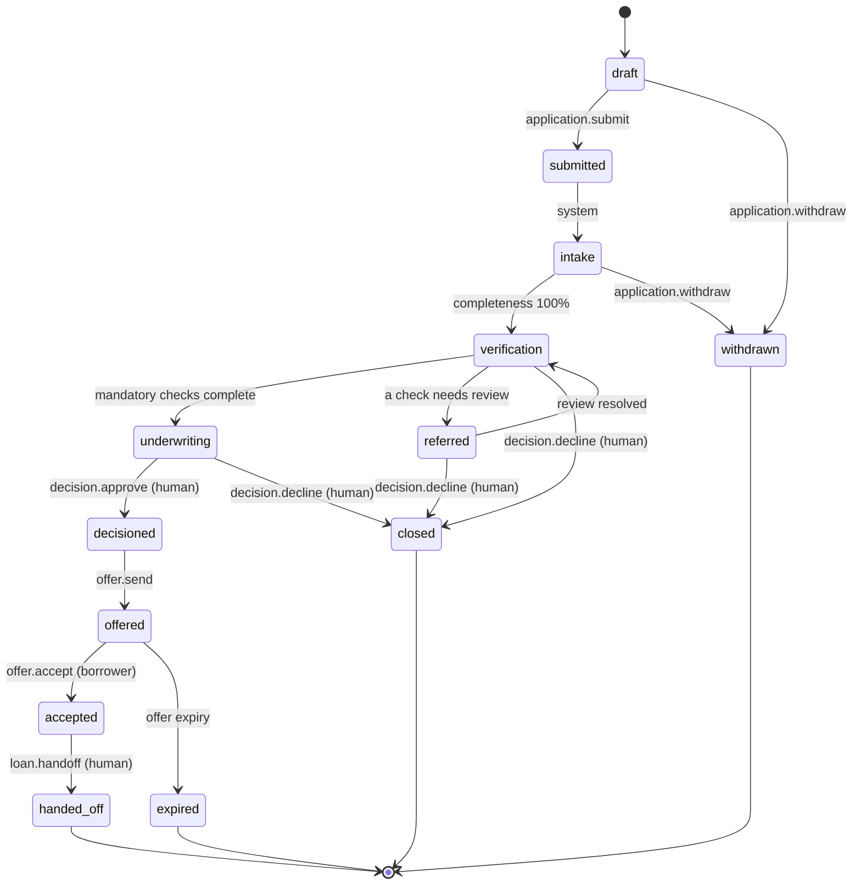

# Spec 05: SME Working-Capital Reference Product

| | |
|---|---|
| **Status** | Draft v0.1 |
| **Date** | 22 October 2026 |
| **Author** | Christopher Tun, TamarindTech |
| **Decision** | [ADR-0002](../adr/0002-first-reference-product-and-market.md) |
| **Source** | [policy-packs/baseline/sme-working-capital/](../../policy-packs/baseline/sme-working-capital) |

> This is a **jurisdiction-neutral baseline**. Thresholds and requirements are illustrative defaults for building and testing Tamarind. They are not credit policy or regulatory advice. Country packs override them.

## 1. Product

| Attribute | Baseline value |
|---|---|
| Product | Unsecured working-capital loan for small and medium businesses |
| Amount | 5,000 – 100,000 (minor units in `pack.yaml`; currency set per country pack) |
| Term | 3 – 24 months, monthly amortising repayments |
| Pricing | Risk-grade table: A 14.00%, B 19.00%, C 26.00% APR |
| Offer validity | 14 days |

## 2. Parties

- **Applicant:** exactly one business.
- **Directors:** at least one individual.
- **Beneficial owners:** every individual owning 25% or more must be added and verified.
- **Guarantor:** required above 50,000.

## 3. Documents

| Document | Required | Notes |
|---|---|---|
| Business registration | Yes | |
| Identity document | Yes, per director, beneficial owner and guarantor | |
| Bank statements | Yes | At least 6 months, or open-banking connection instead |
| Financial statements | Above 25,000 | 2 years |
| Proof of business address | Yes | |
| Management accounts, tax return | Optional | Strengthen the case |

Evidence extracted at 0.90 confidence or higher may be auto-verified. Anything lower goes to human review.

## 4. Checks

| Check | Parties | Mandatory | Consent |
|---|---|---|---|
| KYB | Applicant | Yes | — |
| KYC | Directors, beneficial owners, guarantors | Yes | `kyc` |
| Sanctions / PEP screening | All parties | Yes | — |
| Commercial bureau report | Applicant | Yes | `credit_bureau` |
| Consumer bureau report | Directors, guarantors | No | `credit_bureau` |
| Bank-statement analysis | Applicant | Yes | `bank_data` |

## 5. State machine

Withdrawal is possible from any state up to `underwriting` (not all arrows are drawn). The full definition, including CEL guards, is in [state-machine.yaml](../../policy-packs/baseline/sme-working-capital/state-machine.yaml).

**Change from the reference architecture:** a decline moves the application straight to `closed` and emits `AdverseActionNoticeRequired`. There is no intermediate `decisioned` state for declines.

## 6. Rules (CEL)

A rule passes when its expression is true. A failed **decline** rule is a hard knock-out. A failed **refer** rule sends the case to an approver with the reason.

| ID | Rule | On failure | Reason code |
|---|---|---|---|
| ELG-01 | Amount within product range | decline | `AMOUNT_OUT_OF_RANGE` |
| ELG-02 | Term within product range | decline | `TERM_OUT_OF_RANGE` |
| ELG-03 | Trading for at least 12 months | decline | `INSUFFICIENT_TRADING_HISTORY` |
| ELG-04 | All directors are adults | decline | `DIRECTOR_NOT_ELIGIBLE` |
| CMP-01 | No confirmed sanctions match | decline | `SANCTIONS_MATCH` |
| CMP-02 | Identity verified for all required individuals | refer | `IDENTITY_NOT_VERIFIED` |
| CMP-03 | Business registration verified | refer | `BUSINESS_NOT_VERIFIED` |
| CRD-01 | No serious default in 24 months | decline | `RECENT_SERIOUS_DEFAULT` |
| CRD-02 | Debt service coverage ≥ 1.25 | refer | `LOW_DEBT_SERVICE_COVERAGE` |
| CRD-03 | Amount ≤ 30% of annual revenue | refer | `AMOUNT_HIGH_VS_REVENUE` |
| CRD-04 | At least 6 months of bank history | refer | `INSUFFICIENT_BANK_HISTORY` |
| CRD-05 | Overdrawn on 10 or fewer days in 6 months | refer | `FREQUENT_OVERDRAFT` |

**Outcome:** any failed decline rule → `decline`; otherwise any failed refer rule → `refer`; otherwise `pass`. Test cases live in [tests.yaml](../../policy-packs/baseline/sme-working-capital/tests.yaml).

The rules are inputs to the recommendation, not the decision itself. The underwriting agent combines rule results, metrics and evidence into a recommendation, and a human approves or declines.

## 7. Autonomy

| Stage | Tools | Autonomy |
|---|---|---|
| Intake and documents | `application.create/submit`, `document.*`, `evidence.verify` | L3: agents act, humans handle exceptions |
| Verification | `kyc.run`, `sanctions.screen`, `credit.pull_report`, `bank.analyse_statements` | L3, only with valid consent |
| Recommendation | `decision.recommend` | L2: agent drafts, human confirms |
| Decision | `decision.approve`, `decision.decline` | Human gate |
| Offer | `offer.generate` L3, `offer.send` L2 | |
| Acceptance | `offer.accept` | Borrower only |
| Booking | `loan.handoff` | Human gate |

## 8. Authorization (Cedar)

[authz.cedar](../../policy-packs/baseline/sme-working-capital/authz.cedar) implements:

- **Tenant isolation:** no principal acts on another tenant's applications.
- **Maker-checker:** whoever recommended a decision, or was represented by the recommending agent, cannot approve or decline it.
- **Agents never decide:** agents cannot approve, decline, respond to approvals or hand off loans.
- **Approval authority:** credit approvers approve up to 25,000; senior credit approvers up to 100,000.
- **Least privilege for agents:** intake, verification and underwriting agents each get only their action group.
- **Borrowers:** act only on their own application, through a narrow set of tools.
- **Approval responses:** loan officers, credit approvers and operations staff may respond to approval requests. An approved call then runs as the responder and is authorized again for them, so nobody can approve an action they could not take themselves.

When an agent acts on behalf of a user, the gateway authorizes both and requires both to be allowed.

## 9. Open items

- First country pack, and its design partner (ADR-0002).
- Risk-grade assignment model (scorecard) for pricing.
- Adverse-action notice templates per jurisdiction.
- Synthetic data generator for the evaluation harness.
