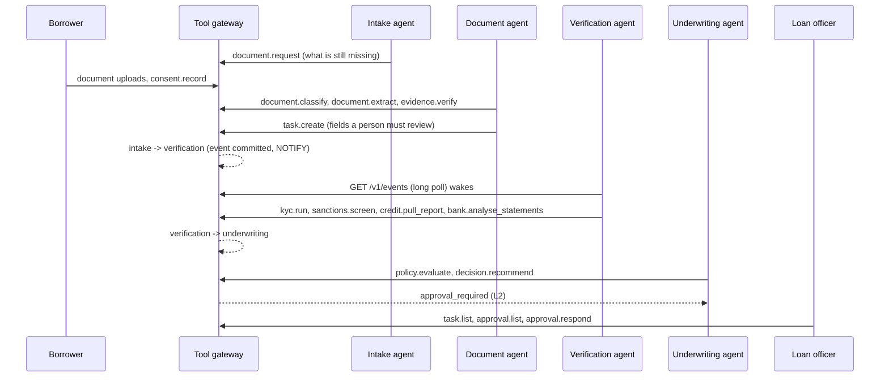

# Tamarind agent runtime

Tamarind's built-in agents, in Python ([ADR-0001](../../docs/adr/0001-core-language.md)). They have no special access: each agent has its own identity and token, calls tools through the gateway over MCP like any external agent, and is limited by the same scopes, Cedar policies and autonomy levels.

> **Phase 0.** Four agents, deterministic playbooks, standard library only. Development tokens; do not use with real data.

## Agents

| Agent | Wakes when | Does | Autonomy |
|---|---|---|---|
| `intake` (`agent:intake`) | The intake grace period after submission ends (`IntakeReviewDue`), or a document request is overdue (`TaskOverdue`) | Asks for each required document that is missing and not already uploaded (`document.request`); the borrower is notified in the portal and the request closes itself when the document is classified. Reminds the borrower when a request is overdue (`task.remind`) and, after the last reminder, hands it to the loan officers | L3 |
| `documents` (`agent:documents`) | A document is attached (`DocumentAttached`) | Classifies and extracts it, then checks each field: verified when read confidently and consistent with the application (name, registration number, date of birth), otherwise needs_review. Fields for review and unrecognised documents become a task for the loan officers | L3; the gateway refuses verification below the confidence threshold |
| `verification` (`agent:verification`) | An application enters `verification` (intake is complete) | Runs KYB, KYC, sanctions, the commercial bureau report and bank-data analysis for each party, skipping checks already done; a consumer report only where the person consented. Results that need review become a task | L3: acts on its own |
| `underwriting` (`agent:underwriting`) | An application enters `underwriting` (all mandatory checks clear) | Runs `policy.evaluate`, then proposes `decision.recommend` with the policy outcome, reason codes and a credit memo that states the risk grade; the gateway prices the terms at the grade | L2: a person must approve the proposal |

A sanctions match or a failed identity check moves the case to `referred` for people, so the underwriting agent never sees it. Approve and decline stay human-only (Cedar forbids agents), whatever the agent proposes.

## How it works



- **Recorded runs.** Each event an agent acts on is one run (`agent.run_start` … `agent.run_finish`). Every call in the run carries its id, so `agent.run_list` shows what the agent did, call by call, and how the run ended: `succeeded`, `escalated` (a person has a task), `failed` or `cancelled` (nothing to do).
- **Escalation is a task.** When an agent cannot finish on its own it creates a task for the loan officers (`task.create`, assignee `role:loan_officer`) with what it found, and the run records the task.
- **Event-driven.** Each agent follows the tenant's event feed (`GET /v1/events`) with its own cursor and long-polls, so it wakes as soon as a state change commits.
- **Idempotent.** Idempotency keys are derived from the triggering event, so re-processing an event (after a crash or restart) replays the original calls rather than repeating them. Agents also re-read the application and act only if it is still in the state that woke them.
- **Layered decisions.** Outcomes and reason codes come from the policy pack's CEL rules. Optionally a model drafts the narrative; it can't change the outcome. The decision record lists the rules pack and any model used.
- **Least data.** The memo is built from terms, metrics, check summaries and rule results. Names and identifiers are not sent to a model.

## Run

With Docker Compose the `agents` service starts with the rest (see [deploy/compose](../../deploy/compose/docker-compose.yml)). To run it by hand against a local gateway:

```bash
cd services/agents
python -m tamarind_agents run              # follow the feed
python -m tamarind_agents once             # process what is there now and exit
python -m tamarind_agents run --agents verification
```

| Variable | Default | |
|---|---|---|
| `TAMARIND_URL` | `http://localhost:8080` | Gateway |
| `TAMARIND_INTAKE_TOKEN`, `TAMARIND_DOCUMENTS_TOKEN`, `TAMARIND_VERIFICATION_TOKEN`, `TAMARIND_UNDERWRITING_TOKEN` | development tokens | One identity per agent |
| `TAMARIND_AGENTS_STATE` | `.tamarind-agents` | Event cursors |
| `TAMARIND_LLM_PROVIDER` | (none) | `anthropic` to let a model draft memos |
| `ANTHROPIC_API_KEY`, `TAMARIND_LLM_MODEL` | (none) | Required with `anthropic`; no model is assumed |

Without a provider, or if the model call fails, the agent writes a deterministic template memo.

## Test

```bash
python -m unittest discover -s tests -v                                # playbooks against a fake gateway
TAMARIND_URL=http://localhost:8080 python -m unittest tests.test_live  # against a gateway started with --intake-grace 2s --timer-interval 1s
```

The live test creates four applications (healthy, thin cash flow, sanctions hit, one missing its bank statements), uploads their documents as the borrower, runs the four agents and checks the results: an approval proposal, a referral with `FREQUENT_OVERDRAFT`, a referred case with no proposal, a recorded run for every agent action, a review task for the low-confidence address, and a document request that the borrower answers and that closes itself before the case moves on. A person then confirms the healthy proposal. CI runs both.

## Next

- Token usage and cost in runs when a model drafts the memo (the runtime records zero today).
- The official MCP Python SDK when the gateway moves to it ([ADR-0005](../../docs/adr/0005-mcp-server-phase-0.md)).
